# Candy Dishwasher Card

<p align="center"></p>

A Home Assistant dashboard card for Candy (Simply-Fi) dishwashers: which stage the cycle is
in, when it will end, whether it still needs emptying, salt and rinse aid warnings, and
start/stop.

It reads the entities created by the **[Candy integration by bigmoby](https://github.com/bigmoby/home-assistant-candy)**
(a maintained fork of ofalvai/home-assistant-candy), so install and set that up first.

## What it shows

| Dishwasher | Card |
|---|---|
| Running (Pre-wash, Wash, Rinse, Drying) | Animated dishwasher, stage stepper, end time, minutes left, program, Stop |
| Finished | When it finished and how long ago, Start |
| Delayed start | When it starts |
| Idle / not reachable | Status and last program, Start when idle |
| Any time | Salt empty, rinse aid empty; door open while running |

- **Stop** asks for a second tap within 3 seconds, because it cancels the program. It is
  also offered during a delayed start.
- **Start** and **Stop** only appear when the Candy integration can send the command. That needs
  remote control enabled on the dishwasher's panel.
- The animation runs only while a cycle runs, and never when the system asks for reduced motion.
- Text is in English or Italian, following your Home Assistant language.

<!-- ha-marketplace:exclude-start -->
## Install

In Home Assistant 2026.11 or newer: **Settings → Marketplace → Add from link**, then enter
`enricodeleo/candy-dishwasher-card`. Adding a link needs a one-time GitHub sign-in.

Manual install: copy `dist/candy-dishwasher-card.js` to `/config/www/`, and add
`/local/candy-dishwasher-card.js` as a JavaScript module resource.
<!-- ha-marketplace:exclude-end -->

## Configuration

Add it from the card picker ("Candy Dishwasher Card"), or in YAML:

```yaml
type: custom:candy-dishwasher-card
entity: sensor.dishwasher
```

| Option | Required | Description |
|---|---|---|
| `entity` | yes | The Candy dishwasher status sensor |
| `name` | no | Card title (default "Dishwasher" / "Lavastoviglie") |
| `needs_emptying` | no | A binary sensor that is on while a finished load waits to be emptied (see below) |
| `hide_controls` | no | Hide Start/Stop (default `false`) |
| `salt`, `rinse_aid`, `door`, `start`, `stop` | no | Override an entity. By default they are found on the dishwasher's device, by the Candy integration's names. Set them if you renamed those entities |

### "Needs emptying"

The dishwasher can't report this, so the card takes it from a binary sensor of your own.
This trigger-based template turns on when a cycle finishes, and turns off when the door
opens or a new cycle starts. It keeps its state across restarts.

```yaml
template:
  - triggers:
      - trigger: state
        entity_id: sensor.dishwasher
        from: [Pre-wash, Wash, Rinse, Drying]
        to: Finished
        id: finished
      - trigger: state
        entity_id: binary_sensor.dishwasher_door
        to: "on"
        id: emptied
      - trigger: state
        entity_id: sensor.dishwasher
        to: [Pre-wash, Wash, Rinse, Drying, Delayed start programmed]
        id: emptied
    binary_sensor:
      - name: Dishwasher needs emptying
        unique_id: dishwasher_needs_emptying
        icon: mdi:dishwasher-alert
        state: "{{ trigger.id == 'finished' }}"
        attributes:
          finished_at: >-
            {{ now().isoformat() if trigger.id == 'finished' else this.attributes.get('finished_at') }}
```

Adjust `sensor.dishwasher` and `binary_sensor.dishwasher_door` to your entity ids. With
`finished_at` the card shows when the load finished, even days later; without the sensor it
uses the time the status became "Finished", which restarts with Home Assistant.

Only a running phase followed by "Finished" counts. That avoids a false "needs emptying"
after a restart, but a cycle that ends while Home Assistant is restarting or the dishwasher is
unreachable is not caught.

## Development

```bash
npm ci
npm run watch      # rebuilds dist/candy-dishwasher-card.js on change
npm run typecheck
```

`dist/` is committed, so the Marketplace can install from the default branch. CI checks it
matches `src/`. To release:
1. Bump `version` in `package.json` and run `npm run build`.
2. Commit, then publish a GitHub release tagged `v<version>`.

The release workflow attaches the built file to the release.

## License

MIT. The dishwasher artwork is part of this project.
